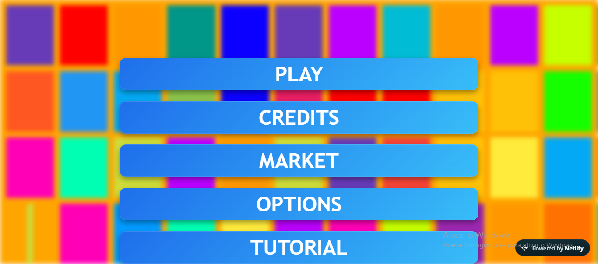
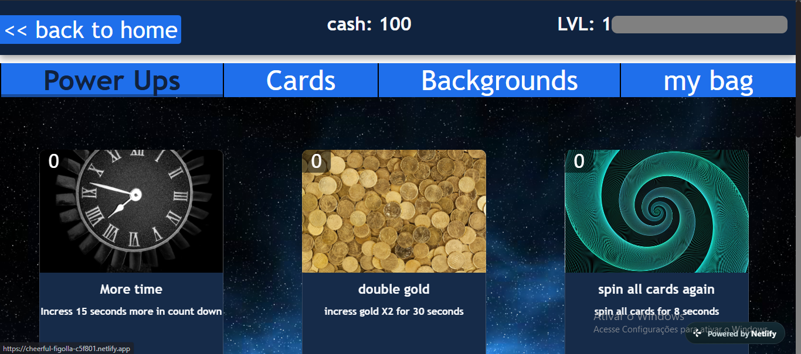

# Memory Game

Um jogo da memória desenvolvido como projeto pessoal para praticar desenvolvimento web, lógica de programação, JavaScript e criação de interfaces interativas.

## 🎮 Jogue agora

<a href="https://cheerful-figolla-c5f801.netlify.app" target="_blank">
  <strong>ACESSAR O JOGO ONLINE</strong>
</a>

Acesse a versão online do Memory Game diretamente pelo navegador.

O projeto está disponível para jogar diretamente pelo navegador, sem necessidade de instalação.

## Screenshots

  
  
  
  

## Sobre o projeto

O Memory Game é um jogo de cartas baseado no clássico jogo da memória. O jogador deve encontrar os pares de cartas enquanto utiliza diferentes recursos disponíveis durante a partida.

O projeto foi desenvolvido inicialmente para funcionar em computador e, posteriormente, passou por uma atualização para melhorar sua compatibilidade, corrigir funcionalidades e preparar a aplicação para publicação em diferentes ambientes.

## Funcionalidades

- Jogo de memória com cartas interativas
- Sistema de pontuação e progressão
- Sistema de ouro e recompensas
- Power-ups
- Mercado para aquisição de itens
- Sistema de áudio e efeitos sonoros
- Sistema de níveis
- Tela de créditos
- Interface temática e responsiva
- Armazenamento de informações do jogador no navegador

## Principais melhorias

A versão atual inclui diversas correções e melhorias, entre elas:

- Melhor compatibilidade com diferentes ambientes e navegadores
- Correção dos controles de música e efeitos sonoros
- Correção da utilização dos power-ups
- Correção da interação com as cartas
- Correção do sistema de compras do mercado
- Ajustes no sistema de economia e recompensas
- Correção de caminhos de arquivos para publicação online
- Correção de referências de arquivos com diferenças entre maiúsculas e minúsculas
- Padronização de fontes e cores da interface
- Atualização e melhoria da tela de créditos

## Tecnologias utilizadas

- HTML5
- CSS3
- JavaScript
- Git / GitHub
- Netlify

## Publicação

O projeto é hospedado e disponibilizado online através do Netlify.

**Versão online:**  
https://cheerful-figolla-c5f801.netlify.app

## Desenvolvedor

Projeto desenvolvido por **Coelho Anon** como projeto pessoal de desenvolvimento web.

Para contato, sugestões, colaborações ou outros projetos:

**coelhoanoncode@gmail.com**
